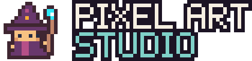

<div align="center">
  <h1>
    
  </h1>
  <p><strong>Make pixel art sprites, tilesets, scenes, and game UI with your coding agent.</strong></p>
  <h3><a href="https://mingfenghong.github.io/pixel-art-studio/">🌐 Project homepage: docs and live demo →</a></h3>
  <p>
    <a href="LICENSE"></a>
    <a href="https://agentskills.io/specification"></a>
    <a href="skills/pixel-art-studio/requirements.txt"></a>
    <a href="THIRD_PARTY_NOTICES.md"></a>
    <a href="https://mingfenghong.github.io/pixel-art-studio/"></a>
  </p>
  <p>
    <a href="https://mingfenghong.github.io/pixel-art-studio/">Homepage</a> ·
    <a href="#installation">Install</a> ·
    <a href="#usage">Usage</a> ·
    <a href="skills/pixel-art-studio/references/few-shots.md">Examples</a> ·
    <a href="skills/pixel-art-studio/SKILL.md">SKILL.md</a> ·
    <a href="README.zh-CN.md">简体中文</a>
  </p>
</div>

---

Describe what you want, share a reference or palette, and get editable sources with crisp PNG exports. Pixel Art Studio is an [Agent Skill](https://agentskills.io) that walks your agent through silhouette, color, composition, animation frames, and export, so a whole set of assets looks like it belongs together. It works with Claude Code, Codex, Gemini CLI, GitHub Copilot, Cursor, OpenCode, and any other host that reads `SKILL.md` folders.


## Contents

- [What you can make](#what-you-can-make)
- [Installation](#installation)
- [Usage](#usage)
- [Hand-drawn art](#hand-drawn-art)
- [Create a UI kit](#create-a-ui-kit)
- [Generate a character](#generate-a-character)
- [Maps, image editing and animation](#maps-image-editing-and-animation)
- [Examples](#examples)
- [How it works](#how-it-works)
- [Repository layout](#repository-layout)
- [Contributing](#contributing)
- [Credits and license](#credits-and-license)

## What you can make

| Asset | Examples |
|---|---|
| Characters | Hand-drawn class figures with walk cycles and attacks, enemies, portraits, emote bubbles, 4/8-direction generator characters |
| Props and icons | Tools, food, furniture, quest items, inventory sets |
| Environments | Hand-drawn tilesets assembled on a grid with autotiling and parallax, procedural top-down terrain, isometric blocks |
| Game UI | HUDs, bars, hotbars, lists, shops, NPC dialogue boxes, day/night dials, menus, tooltips; three frame styles |
| Animation and effects | Frame imports, parented layers, keyframes, cutout poses, floating text, GIFs |
| Image editing | Recolor, palette reduction, background keying, masked patches, resize and canvas extension |
| Reference-driven work | Text, style, and concept references, semantic edits, turnarounds, and motion through your agent's own image tools (PixelLab optional) |

Bring your own reference images, palette, canvas size, and drawing style. The skill works with explicit pixel grids, existing assets, pixel editors, and whatever image tools your agent has. Everything runs locally: no account, API key, or network connection is needed.

## Installation

The skill is the folder [`skills/pixel-art-studio`](skills/pixel-art-studio). Every installation method below puts that complete folder, not just `SKILL.md`, where your agent looks for skills.

### Let your agent install it

Paste this into Claude Code, Codex, Gemini CLI, Copilot, Cursor or any other coding agent:

```text
Please read the install instructions at https://github.com/MingfengHong/pixel-art-studio/blob/main/INSTALL.md and install Pixel Art Studio for me.
```

[INSTALL.md](INSTALL.md) is a runbook written for agents: it identifies the host, copies the skill into the right folder, checks Python, runs a smoke test, and reports back. It asks before installing Python packages or overwriting an existing copy, and it never sets up PixelLab.

### Quick install (any agent)

The community [`skills` CLI](https://github.com/vercel-labs/skills) (Node.js 22.20+) detects your agents and installs into the right directory:

```bash
npx skills add MingfengHong/pixel-art-studio
```

Add `-g` to install for your user instead of the current project, and `-a <agent>` to pick a target, for example `-a claude-code`, `-a codex`, `-a gemini-cli`, `-a github-copilot`, `-a cursor`, or `-a opencode`.

### Claude Code

**Option A: plugin marketplace.** Inside Claude Code, run:

```text
/plugin marketplace add MingfengHong/pixel-art-studio
/plugin install pixel-art-studio@pixel-art-studio
```

Update later with `/plugin marketplace update pixel-art-studio`.

**Option B: copy the folder.** Use `~/.claude/skills/` for every project, or `.claude/skills/` inside one project to share it with your team:

```bash
git clone https://github.com/MingfengHong/pixel-art-studio.git
mkdir -p ~/.claude/skills
cp -R pixel-art-studio/skills/pixel-art-studio ~/.claude/skills/
```

Start a new session and ask "What skills are available?" to confirm it loaded.

### Claude.ai and Claude Desktop

1. Download `pixel-art-studio.skill` from the [latest release](https://github.com/MingfengHong/pixel-art-studio/releases/latest), or build it with `python tools/package_skill.py`. The file is a ZIP archive; rename it to `.zip` if the uploader asks for one.
2. Make sure code execution is turned on, then open **Customize → Skills** (labelled **Settings → Capabilities** in some versions) and upload the file.

Custom skills on Claude.ai are per user and need a plan with code execution.

### Codex

Codex reads `~/.agents/skills/` for your user and `.agents/skills/` inside a repository:

```bash
git clone https://github.com/MingfengHong/pixel-art-studio.git
mkdir -p ~/.agents/skills
cp -R pixel-art-studio/skills/pixel-art-studio ~/.agents/skills/
```

You can also ask Codex to install it with the built-in installer skill:

```text
$skill-installer install https://github.com/MingfengHong/pixel-art-studio/tree/main/skills/pixel-art-studio
```

Restart Codex if the skill does not show up.

### Gemini CLI

```bash
gemini skills install https://github.com/MingfengHong/pixel-art-studio.git --path skills/pixel-art-studio
```

Add `--scope workspace` to install into the current project. Gemini CLI also reads `~/.gemini/skills/` and `~/.agents/skills/`, so a copy made for Codex works here too. Check with `/skills list`.

### GitHub Copilot

Copy the folder into `~/.copilot/skills/` (or `~/.agents/skills/`) for your user, or into `.github/skills/` in a repository. Copilot CLI, VS Code agent mode, and the Copilot cloud agent all read these locations.

### Cursor, OpenCode, Windsurf, and other hosts

Copy the folder into the host's skills directory. The common locations are:

| Agent | User directory | Project directory |
|---|---|---|
| Claude Code | `~/.claude/skills/` | `.claude/skills/` |
| Codex | `~/.agents/skills/` | `.agents/skills/` |
| Gemini CLI | `~/.gemini/skills/` or `~/.agents/skills/` | `.gemini/skills/` or `.agents/skills/` |
| GitHub Copilot | `~/.copilot/skills/` or `~/.agents/skills/` | `.github/skills/` or `.agents/skills/` |
| Cursor | `~/.cursor/skills/` | `.agents/skills/` |
| OpenCode | `~/.config/opencode/skills/` | `.opencode/skills/` or `.agents/skills/` |
| Windsurf | `~/.codeium/windsurf/skills/` | `.windsurf/skills/` |

Directory conventions change between releases; if a path does not work, check your agent's documentation or use `npx skills add`.

**Windows (PowerShell)** — replace the destination with your agent's directory:

```powershell
git clone https://github.com/MingfengHong/pixel-art-studio.git
$dest = Join-Path $HOME '.claude/skills'
New-Item -ItemType Directory -Force -Path $dest | Out-Null
Copy-Item -LiteralPath 'pixel-art-studio/skills/pixel-art-studio' -Destination $dest -Recurse -Force
```

### Python helpers (optional)

The local art tools need Python 3.10+ and [Pillow](https://python-pillow.org). Install the dependency once from the installed skill folder:

```bash
python -m pip install -r requirements.txt
```

Without Python, the agent can still design assets with its own image tools; it will tell you which checks it skipped.

### PixelLab (optional)

You do not need PixelLab. Every feature above works without it, and the skill never contacts PixelLab or asks for a token unless you request it.

If you already use [PixelLab](https://www.pixellab.ai) and want your agent to call it for generation, either connect PixelLab's MCP server in your agent, or install the bundled client's extra dependencies and set your token in the environment:

```bash
python -m pip install -r requirements-pixellab.txt
export PIXELLAB_API_KEY=...   # PowerShell: $env:PIXELLAB_API_KEY = '...'
```

Then ask for PixelLab explicitly, for example "use PixelLab to generate…". The agent confirms before making calls that spend your credits. See the [PixelLab section](skills/pixel-art-studio/references/production-workflows.md#optional-pixellab-connection) for details.

### Update or uninstall

For copied installs, delete the `pixel-art-studio` folder from your agent's skills directory and copy the latest folder in its place. With the `skills` CLI, run `npx skills add MingfengHong/pixel-art-studio` again. With the Claude Code plugin, use `/plugin marketplace update pixel-art-studio` or `/plugin uninstall pixel-art-studio@pixel-art-studio`.

## Usage

Most agents load the skill automatically when you ask for pixel art. To call it by name:

| Agent | Explicit invocation |
|---|---|
| Claude Code | `/pixel-art-studio` (folder install) or `/pixel-art-studio:pixel-art-studio` (plugin install) |
| Codex | `$pixel-art-studio` |
| Gemini CLI, Copilot, others | Mention "pixel-art-studio" in your request |

**Inventory icons**

> Create six 24×24 inventory icons with pixel-art-studio: a lantern, key, potion, bread, compass, and pouch. Use my palette and a one-pixel outline. Deliver editable sources and a PNG atlas.

**Directional character**

> Use pixel-art-studio to make a 16×16 researcher with glasses, long hair, and a pale coat. Include front, back, left, and right views, idle and walk animations, editable frames, and a PNG atlas.

**Village scene**

> Use pixel-art-studio to build a small riverside village with two houses, a bridge, and a dirt path. Include an editable layered layout and a PNG preview.

**Game UI**

> Use pixel-art-studio to make a dark fantasy HUD with health, mana, and XP bars, a minimap, and a settings menu with sliders and toggles. Include state PNGs, nine-slice skins, and an interactive preview.

**Match an existing style**

> Here is a screenshot of my game. Use pixel-art-studio to draw three new enemies that match its palette, outline, and proportions.

The agent sets the visual direction, makes one representative sample, develops the set, and refines it at native size and integer zoom. Typical deliverables are editable source files, PNGs or an atlas, a preview, and frame or layout metadata.

## Hand-drawn art

Final game art is placed pixel by pixel. The skill teaches agents to author tiles, sprites, portraits and icons as editable grid sources, then assemble and check them with its tools. Backgrounds are built from tiles on a grid, never painted as one image.


```bash
python skills/pixel-art-studio/scripts/tilemap.py skills/pixel-art-studio/assets/examples/side-scroller/scene.json --out output/meadow
```

- **[Side-scroller](skills/pixel-art-studio/assets/examples/side-scroller):** a hand-drawn terrain and background tileset, big trees, props, a hero and icons. `tilemap.py` assembles them with autotiled edges and parallax layers, and `ui.py` adds a full HUD.
- **[RPG kit](skills/pixel-art-studio/assets/examples/rpg-kit):** four 16×16 class figures (warrior, mage, summoner, archer) and a merchant with walk cycles, class attacks with fireball, arrow and wisp projectiles, a fireball skill animation, a slime, bat, goblin, mushroom, ghost and skeleton with attack or hurt frames, slash, hit and heal effects, emote bubbles, and 24 item icons. Portraits are crops of the sprites.
- **[Hand-authoring guide](skills/pixel-art-studio/references/hand-authoring.md):** the workflow, the quality bar, tile anatomy, characters, portraits, emotes and icons.


## Create a UI kit

Generate an RPG interface (town HUD, dialogue, inventory and equipment, battle, shop, character select) from the repository root:

```bash
python skills/pixel-art-studio/scripts/ui.py skills/pixel-art-studio/assets/examples/interface-kit/recipe.json --out output/interface
```

Open `output/interface/preview.html` in a browser, or try the [live playground](https://mingfenghong.github.io/pixel-art-studio/#playground). The [docs site](https://mingfenghong.github.io/pixel-art-studio/docs/ui-kit.html) walks through every component. Pick belt slots and shop rows, read the typewriter dialogue and choose an answer, scroll the bag, and hover items for tooltips.

| Family | Included components |
|---|---|
| HUD | Labelled health/mana/XP/stamina bars, minimap, day/night dial, hotbar |
| Controls | Icon, stacked and round buttons, toggle/switch, slider, dropdown |
| Menus | Panel, canvas, scroll view with empty slots, list (shops, quests, stats) |
| Story | NPC dialogue box with portrait, name, typewriter frames and choices |
| Text and media | Outlined text, framed or slotted images, hand-drawn frames via `set.json#frame` |
| Feedback | Modal, tooltip, floating text |

The kit exports native state PNGs, text-free nine-slice skins, separate fill/track/thumb/content layers, a packed atlas, layout metadata, and composed screen previews. Edit the recipe's palette, corner treatment, sizes, labels, values, and placements to create another visual style. The [UI guide](skills/pixel-art-studio/references/ui.md) documents every component and the optional font path for multilingual labels.

## Generate a character

The character generator combines material colors with hair, glasses, hats, beards, coats, and aprons. From the repository root, start with the researcher recipe:

```bash
python skills/pixel-art-studio/scripts/character.py skills/pixel-art-studio/assets/examples/characters/researcher/recipe.json --out output/researcher
```

This creates **16 poses across four directions**, an editable pixel grid, a transparent PNG atlas, frame and animation metadata, a contact sheet, and idle/walk GIFs.

Set `"directions": 8` for 32 poses, or start with the [adventurer recipe](skills/pixel-art-studio/assets/examples/characters/adventurer/recipe.json). Its diagonal views use separately drawn grids. [View the eight-direction walk](skills/pixel-art-studio/assets/examples/characters/adventurer/walk.gif).


To make another character, save a recipe such as `my-character.json`:

```json
{
  "name": "shopkeeper",
  "parts": ["long-hair", "apron", "glasses"],
  "colors": {
    "hair": "#8d5138",
    "hair_shadow": "#573529",
    "top": "#708fa2",
    "top_shadow": "#465d78",
    "apron": "#e6d6a9"
  }
}
```

Pass that file to `character.py` with an output folder. The [character guide](skills/pixel-art-studio/references/sprites.md#generate-a-directional-character) covers every color role, part, timing field, and the template format. The starter template is 16×16; edit its grids and parts for other proportions.

## Maps, image editing and animation

Run these complete recipes from the repository root:

```bash
python skills/pixel-art-studio/scripts/world.py skills/pixel-art-studio/assets/examples/world-workshop/recipe.json --out output/world
python skills/pixel-art-studio/scripts/image_ops.py skills/pixel-art-studio/assets/examples/image-editing/recipe.json --out output/potion-edit
python skills/pixel-art-studio/scripts/animate.py skills/pixel-art-studio/assets/examples/layered-animation/recipe.json --out output/attack
```

- **World workshop:** a top-down town on procedural ground (grass variants, paths, farmland, a pond with banks) with hand-drawn houses, trees, props and the RPG cast.
- **Image editing:** remove a flat background, recolor, outline, extend the canvas and composite a patch. Other operations include masking, pixelation, palette matching, cropping and resizing.
- **Animation:** import an existing frame sequence or animate parented layers with position, rotation and opacity keyframes. Export native frames, timing/pivot data, atlas and GIF.

These tools run locally with Pillow. For freeform images, style and concept references, semantic inpainting, reference character rotation, outfit transfer, and generated actions, the [generation workflow](skills/pixel-art-studio/references/production-workflows.md) uses your agent's image tools or redraws on the native grid. PixelLab can be added for these tasks, but is never required.

## Examples

The [example collection](skills/pixel-art-studio/assets/examples) includes source files and rendered outputs:

- **Side-scroller**: hand-drawn tiles, props, trees and hero assembled into a parallax scene with a full mobile-style HUD.
- **RPG kit**: four hand-drawn class figures and a merchant with walk and attack frames, six enemies, projectiles and effects, emote bubbles and 24 item icons.
- **Interface kit**: an RPG town HUD, dialogue, inventory and equipment, turn-based battle, shop and character select, with an interactive preview.
- **Characters**: four-direction researcher/ranger and eight-direction adventurer, with palettes, parts and idle/walk clips.
- **World workshop**: a top-down town map with layered objects and shadows.
- **Image editing**: an enchanted potion with transparent background, recolor, outline and sparkle patch.
- **Layered animation**: an editable character-and-sword action with parented keyframes.
- **Skill cast**: a fireball skill staged from hand-drawn frames on keyframed layers.
- **Potion variants**: one silhouette in three color treatments.
- **Tile scene**: a cottage and trees assembled from modular terrain and building tiles.
- **UI components**: small controls and a panel in one visual family.
- **Beacon**: an 8×8 light with two poses and a three-color palette.


The [worked examples](skills/pixel-art-studio/references/few-shots.md) explain the brief and drawing decisions behind each one. To render an included source directly:

```bash
python skills/pixel-art-studio/scripts/pixel_art.py render skills/pixel-art-studio/assets/examples/potion-variants/source.json --out output/potions
```

This writes `atlas.png`, `atlas.json`, and `preview.png`. See [tools and file formats](skills/pixel-art-studio/references/tools-and-export.md) for every command.

## How it works

The skill follows the [progressive disclosure](https://agentskills.io/specification#progressive-disclosure) model of Agent Skills. Your agent always sees the short description; it reads [`SKILL.md`](skills/pixel-art-studio/SKILL.md) only when you ask for pixel art, and opens a topic guide (sprites, environments, UI, animation, image editing, export) only when the task needs it. The recipe tools are deterministic and run locally with Pillow and no network access. Freeform generation uses your agent's own image tools; the optional PixelLab client is used only when you set it up and ask for it.

## Repository layout

```text
pixel-art-studio/
├── INSTALL.md                        Install runbook for agents
├── .claude-plugin/marketplace.json   Claude Code plugin marketplace entry
├── skills/pixel-art-studio/          The skill (install this folder)
│   ├── SKILL.md                      Entry point: workflow and commands
│   ├── references/                   Topic guides loaded on demand
│   ├── scripts/                      Grid, tilemap, UI, character, world, image and animation tools
│   │   └── pixellab.py               Optional PixelLab client (not needed by other tools)
│   ├── assets/examples/              Example sources and rendered outputs
│   ├── assets/templates/             Character grids, browser preview, style brief
│   ├── assets/kenney/                Selected CC0 reference tiles
│   ├── agents/openai.yaml            Codex display metadata
│   ├── requirements.txt              Pillow (all local tools)
│   └── requirements-pixellab.txt     Optional PixelLab client dependencies
├── .github/workflows/pages.yml      Builds and deploys the project site
├── site/                             Docs site sources (home page text, bilingual guides, styles)
└── tools/                            Maintainer scripts (rebuild examples, package, build site)
```

## Contributing

Contributions are welcome: new examples, clearer drawing guidance, and practical tool improvements. Please open an issue first for larger changes.

- When sharing artwork, include a short description, an editable source, and a preview. Credit reference artists and include the source license.
- Keep `SKILL.md` short; put detailed guidance in `references/`.
- Rebuild the examples with `python tools/rebuild_examples.py` after changing scripts or sources.
- Build the uploadable archive with `python tools/package_skill.py`; it is written to `dist/pixel-art-studio.skill`.

## Credits and license

The bundled references include 33 tiles from [Kenney](https://kenney.nl/assets)'s Tiny Dungeon, Tiny Town, and UI Pack – Pixel Adventure collections. The examples draw on their compact silhouettes, clear color clusters, and modular construction. These assets are released under **CC0**; see [credits and sources](skills/pixel-art-studio/assets/kenney/ATTRIBUTION.md).

The skill follows the [Agent Skills specification](https://agentskills.io/specification), with inspiration from [Anthropic Skills](https://github.com/anthropics/skills), [Superpowers](https://github.com/obra/superpowers), and [pixel-art](https://github.com/wan-huiyan/pixel-art).

Code and documentation are licensed under [MIT](LICENSE). Included artwork is described in [third-party notices](THIRD_PARTY_NOTICES.md).
