# Worked examples

Each example pairs a short brief with drawing decisions, editable source, and a rendered result. Potion, scene, and UI examples use selected [Kenney CC0 assets](../assets/kenney/ATTRIBUTION.md). Browse the [reference sheet](../assets/kenney/contact-sheet.png) to see the included shapes, colors, and components.

All examples were made with the local tools only; none needs a network connection or PixelLab.

## Directional characters

**Brief:** Make a researcher with glasses, long hair, and a pale coat, plus a ranger with a cap and beard. Use a shared 16×16 body template, four directions, and looping idle and walk animations.

**Reference:** The compact silhouettes and large head shapes in [Tiny Dungeon characters](../assets/kenney/tiny-dungeon-contact.png). The bundled character template and parts are authored for this project.

Give each material a color role, then compose the silhouette with ordered parts. The researcher uses `long-hair`, `coat`, and `glasses`, with cool hair, a pale coat, and dark trousers. The ranger uses `cap` and `beard`, with green clothing and warm brown accessories. Keep the same canvas and foot pivot across the cast.

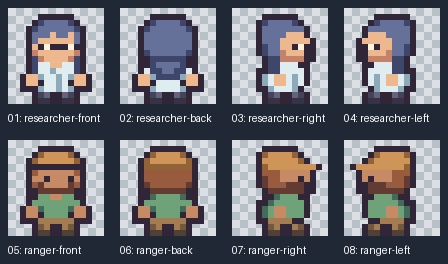

| Character | Recipe | Editable frames | Atlas | Animation clips |
|---|---|---|---|---|
| Researcher | [Recipe](../assets/examples/characters/researcher/recipe.json) | [Source](../assets/examples/characters/researcher/source.json) | [PNG](../assets/examples/characters/researcher/atlas.png) | [Clips](../assets/examples/characters/researcher/animations.json) |
| Ranger | [Recipe](../assets/examples/characters/ranger/recipe.json) | [Source](../assets/examples/characters/ranger/source.json) | [PNG](../assets/examples/characters/ranger/atlas.png) | [Clips](../assets/examples/characters/ranger/animations.json) |

Draw front, back, and right views, then mirror the right view for this symmetric outfit. A one-pixel upper-body dip creates the alternate idle pose. Lift each foot in turn and insert the standing pose between steps for a four-frame walk loop. All frames retain the `[8,16]` pivot.

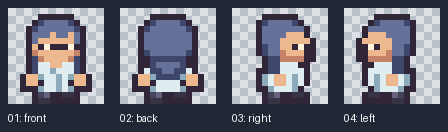

From the installed skill folder:

```sh
python scripts/character.py assets/examples/characters/researcher/recipe.json --out output/researcher
```

Use the [character workflow](sprites.md#generate-a-directional-character) to change material colors, combine parts, or draw a new template. The [researcher contact sheet](../assets/examples/characters/researcher/preview.png) shows every pose; the [ranger walk loop](../assets/examples/characters/ranger/walk.gif) demonstrates the same motion with a second outfit.

## Potion variants

**Brief:** Make three matching 16×16 potion icons, preserving the bottle shape and giving two variants blue and purple fills.

**Reference:** [Tiny Dungeon 0113](../assets/kenney/tiny-dungeon/tile_0113.png), alongside [0114](../assets/kenney/tiny-dungeon/tile_0114.png) and [0115](../assets/kenney/tiny-dungeon/tile_0115.png).

The silhouette uses a dark boundary, a brown stopper, and two gray fill colors. Preserve the geometry and stopper. Replace `#c0cbdc / #8b9bb4` with `#8fe6ff / #2582c4` for azure and `#d0b8ff / #8062bd` for violet. This keeps the items recognizable as one family while making the variants easy to distinguish.

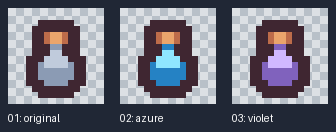

[Source](../assets/examples/potion-variants/source.json) · [Native atlas](../assets/examples/potion-variants/atlas.png) · [Metadata](../assets/examples/potion-variants/atlas.json)

Use these as separate inventory items. Their frame timing fields use the file format's default value.

## Modular cottage scene

**Brief:** Build a small top-down cottage scene with an editable layout.

**Reference:** [Tiny Town tiles](../assets/kenney/tiny-town-contact.png), including a nine-piece dirt patch, roof and wall modules, and a two-tile tree.

Work on a 16 px grid with ground and object layers. Assemble roof rows `48/49/50` and `60/61/62`, followed by wall/door row `72/74/75`. Place tree tile `4` above `16`. Use the dirt patch's edge and corner pieces to connect the doorway to a small clearing.

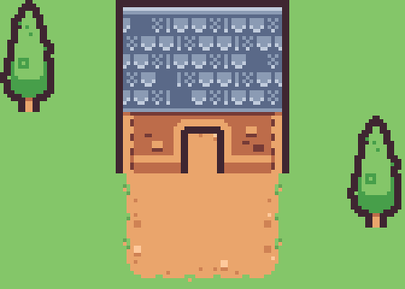

[7×5 layout](../assets/examples/tile-scene/layout.json) · [112×80 scene](../assets/examples/tile-scene/scene.png)

The layered layout makes it easy to move the house, extend the ground, or change the composition while keeping module alignment.

## Small UI components

**Brief:** Prepare a sheet of compact rounded controls and a small panel.

**Reference:** UI Pack – Pixel Adventure, Small tiles / Thin outline, files `0000`, `0001`, `0002`, and `0033`.

Keep the pack's thin border treatment and native 16×16 size. Label the empty, plus, and star controls by their content. Pair them with the square panel as a starting point for a small interface.

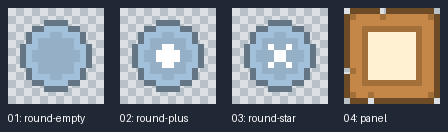

[Source](../assets/examples/ui-components/source.json) · [Native atlas](../assets/examples/ui-components/atlas.png) · [Metadata](../assets/examples/ui-components/atlas.json)

For a complete interface, develop the requested interaction states and choose panel insets using the [UI guide](ui.md).

## Three-color beacon

**Brief:** Draw an 8×8 light using three muted colors, an outline-free silhouette, and two poses.

Use cream, green, and teal to separate the light from its base. Keep the base anchor stable and expand the light shape in the second pose. Set durations to 400 ms and 200 ms.

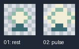

[Source](../assets/examples/beacon/source.json) · [Native atlas](../assets/examples/beacon/atlas.png) · [Timing and pivot](../assets/examples/beacon/atlas.json)

## Hand-drawn side-scroller

**Brief:** A side-view adventure scene in a bright, chunky mobile style, with layered parallax, dithered foliage, strong outlines and a full HUD.

Every tile and sprite is typed pixel by pixel in [grid sources](../assets/examples/side-scroller):
- `tiles.json`: terrain with corners, sides, stone variants, platforms and water, plus background tiles for clouds, far mountains, hills and the tree line.
- `props.json`: bushes, rocks, crates, barrels, a campfire, a fence, a lantern, mushrooms and a slime.
- `big.json`: a round tree, a pine and a distant windmill.
- `hero.json` and `items.json`: the archer hero (stand and walk) and the item and UI icons.

`tilemap.py` assembles the [scene](../assets/examples/side-scroller/scene.json) on a 16 px grid, choosing terrain edges from neighbours and seating props into the grass. `ui.py` lays the [HUD](../assets/examples/side-scroller/hud.json) over it with the `arcade` style.

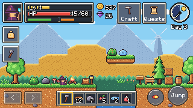

[Tile sheet](../assets/examples/side-scroller/sheets/tiles/preview.png) · [Props](../assets/examples/side-scroller/sheets/props/preview.png) · [Scene layers](../assets/examples/side-scroller/scene/layers) · [Map data](../assets/examples/side-scroller/scene/map.json)

## RPG kit and interface

**Brief:** Characters, portraits, icons and menus for a small fantasy RPG, with an original plum-and-gold interface.

- **Cast:** [warrior.json](../assets/examples/rpg-kit/warrior.json), [mage.json](../assets/examples/rpg-kit/mage.json), [summoner.json](../assets/examples/rpg-kit/summoner.json) and [archer.json](../assets/examples/rpg-kit/archer.json) are 16×16 class figures in three directions with walk frames, plus a merchant. [class-actions.json](../assets/examples/rpg-kit/class-actions.json) holds their attacks and [projectiles.json](../assets/examples/rpg-kit/projectiles.json) a fireball, an arrow and a wisp.
- **Portraits:** the HUD, dialogue, shop and party list crop the sprite's head and shoulders and show them at 2–3×.
- **Icons:** [items.json](../assets/examples/rpg-kit/items.json) holds 24 icons that share one light direction and outline color.
- **Enemies:** a slime, a bat and a club-swinging goblin, plus [enemies.json](../assets/examples/rpg-kit/enemies.json) with a hopping mushroom, a floating ghost and a sword skeleton, each with idle, attack or hurt frames.
- **Effects:** a slash, a hit spark and a heal, three frames each.
- **Expressions:** [emotes.json](../assets/examples/rpg-kit/emotes.json) holds seven 12×12 bubbles (alert, question, heart, anger, dots, note, idea) shown above any character.
- **Interface:** the [interface recipe](../assets/examples/interface-kit/recipe.json) recolors the `arcade` style. The mage Mira is the lead. It has a town HUD, an inset-portrait dialogue with choices, an equipment and inventory screen, a shop list, a battle screen and a character select screen that shows the stand frame at 5×.

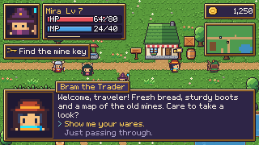

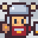 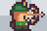 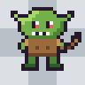

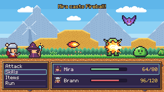

[Characters](../assets/examples/rpg-kit/sheets/warrior/preview.png) · [Emotes](../assets/examples/rpg-kit/sheets/emotes/preview.png) · [Icons](../assets/examples/rpg-kit/sheets/items/preview.png) · [Browser preview](../assets/examples/interface-kit/preview.html)

## Eight-direction adventurer

**Brief:** Extend the cast to eight directions, keeping identity, costume and foot pivot consistent.

The front-right and back-right grids add diagonal silhouettes to the cardinal views. Mirror the left counterparts for this outfit, then generate four poses per direction. Preserve the native 16×16 grid and the shared pivot.

[Recipe](../assets/examples/characters/adventurer/recipe.json) · [Source](../assets/examples/characters/adventurer/source.json) · [Walk playback](../assets/examples/characters/adventurer/walk.gif)

## Town map

**Brief:** A small top-down town for the RPG screens.

`world.py` generates the ground procedurally: grass variants, a dirt road, tilled farmland and a pond with banks. On top of it go hand-drawn houses and trees from [town.json](../assets/examples/world-workshop/town.json) (a cottage in two roof colors, a shop with an awning, a well and a tree), crates, barrels, a lantern and a sign, herbs planted in the field, and the four RPG characters. Objects are sorted by their base and cast soft shadows.

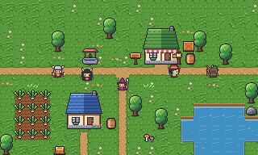

[Recipe](../assets/examples/world-workshop/recipe.json) · [Tiles](../assets/examples/world-workshop/atlas.png) · [Map data](../assets/examples/world-workshop/map.json)

## Potion editing

**Brief:** Turn a gray potion on a flat background into a purple magical item with a silhouette outline and small sparkle.

Remove only matching border-connected background pixels, replace the two fill colors, add an outline, expand the canvas, and composite the sparkle.

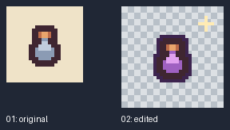

[Portable recipe](../assets/examples/image-editing/source.json) · [Result](../assets/examples/image-editing/image.png) · [Operations](image-editing.md)

## Layered sword action

**Brief:** Make a short editable weapon action from an existing character and a separately drawn sword.

Place both parts on a shared 48×48 canvas. Attach the sword's grip pivot to the character layer, key its swing, and interpolate snapped positions and rotation. The source keeps the body and weapon independently editable.

[Recipe](../assets/examples/layered-animation/source.json) · [Playback](../assets/examples/layered-animation/preview.gif) · [Frame timing](../assets/examples/layered-animation/animation.json)

## Render an example

From the skill folder, render a sprite example with:

```sh
python scripts/pixel_art.py render assets/examples/potion-variants/source.json --out output/potions --scale 6
```

The tile scene includes both its layered placement data and rendered PNG.
